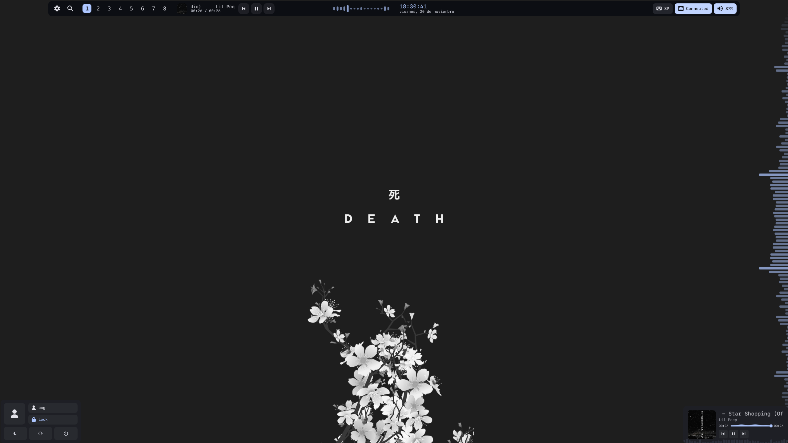

<div align="center">

# ✦ dotfiles

**NixOS · Hyprland · Home Manager**




</div>

---

## 🖥️ Setup

| | |
|---|---|
| **OS** | NixOS 26.11 (flake, `nixos-unstable`) |
| **WM** | Hyprland (Wayland) with the [serpantinum](https://github.com/ilyamiro/serpantinum) shell |
| **Login** | SDDM |
| **Terminal** | kitty |
| **Prompt** | starship |
| **Editor** | micro |
| **GTK theme** | WhiteSur-Dark + WhiteSur icons + WhiteSur cursor |
| **Extras** | fastfetch, btop, cava, easyeffects, OBS |
| **Hardware** | Ryzen 7 5700X · RTX 5070 · 32 GB RAM |

## 📁 Layout

```
dotfiles/
├── nixos/      # declarative system configuration
│   ├── flake.nix
│   ├── configuration.nix
│   ├── modules/    # nix, boot, cpu, nvidia, network, desktop, apps, ollama…
│   └── home/       # Home Manager: hyprland, kitty, starship, btop, theme…
├── config/     # ~/.config as-is (hypr, kitty, cava, fastfetch…)
└── home/       # loose dotfiles from ~ (.bashrc, .profile, .Xresources…)
```

`nixos/` is the source of truth: it describes the system and generates much of what lives in `config/`. That folder is a copy of what ends up applied in `~/.config`.

## 🚀 Usage

> ⚠️ `nixos/hardware-configuration.nix` is specific to **my** machine. If you try this on yours, generate your own with `nixos-generate-config` and replace it.

```bash
git clone https://github.com/bagpotato/dotfiles.git
cd dotfiles/nixos
sudo nixos-rebuild switch --flake .#nixos
```

To update the inputs:

```bash
nix flake update
sudo nixos-rebuild switch --flake .#nixos
```

## 🎨 Credits

- [serpantinum](https://github.com/ilyamiro/serpantinum) by ilyamiro
- [WhiteSur](https://github.com/vinceliuice/WhiteSur-gtk-theme) by vinceliuice
- [Hyprland](https://hyprland.org) and [Home Manager](https://github.com/nix-community/home-manager)
