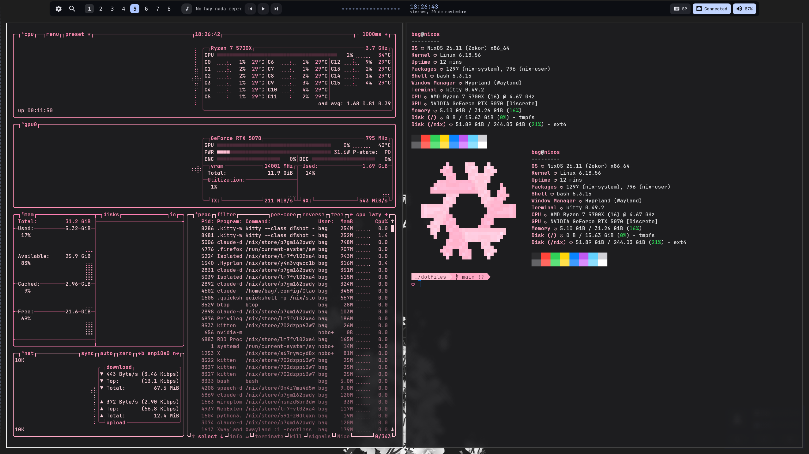

<div align="center">

# ✦ dotfiles

**NixOS · Hyprland · Home Manager**




</div>

---

## 🖥️ Setup

| | |
|---|---|
| **OS** | NixOS 26.11 (flake, `nixos-unstable`) |
| **WM** | Hyprland (Wayland) con shell [serpantinum](https://github.com/ilyamiro/serpantinum) |
| **Login** | SDDM |
| **Terminal** | kitty |
| **Prompt** | starship |
| **Editor** | micro |
| **Tema GTK** | WhiteSur-Dark + iconos WhiteSur + cursor WhiteSur |
| **Extras** | fastfetch, btop, cava, easyeffects, OBS |
| **Hardware** | Ryzen 7 5700X · RTX 5070 · 32 GB RAM |

## 📁 Estructura

```
dotfiles/
├── nixos/      # configuración declarativa del sistema
│   ├── flake.nix
│   ├── configuration.nix
│   ├── modules/    # nix, boot, cpu, nvidia, red, desktop, apps, ollama…
│   └── home/       # Home Manager: hyprland, kitty, starship, btop, tema…
├── config/     # ~/.config tal cual (hypr, kitty, cava, fastfetch…)
└── home/       # dotfiles sueltos de ~ (.bashrc, .profile, .Xresources…)
```

`nixos/` es la fuente de verdad: describe el sistema y genera buena parte de lo que hay en `config/`. Esa carpeta es una copia de lo que queda aplicado en `~/.config`.

## 🚀 Uso

> ⚠️ `nixos/hardware-configuration.nix` es de **mi** máquina. Si lo pruebas en la tuya, genera el tuyo con `nixos-generate-config` y reemplázalo.

```bash
git clone https://github.com/bagpotato/dotfiles.git
cd dotfiles/nixos
sudo nixos-rebuild switch --flake .#nixos
```

Para actualizar las dependencias:

```bash
nix flake update
sudo nixos-rebuild switch --flake .#nixos
```

## 🎨 Créditos

- [serpantinum](https://github.com/ilyamiro/serpantinum) por ilyamiro
- [WhiteSur](https://github.com/vinceliuice/WhiteSur-gtk-theme) por vinceliuice
- [Hyprland](https://hyprland.org) y [Home Manager](https://github.com/nix-community/home-manager)
